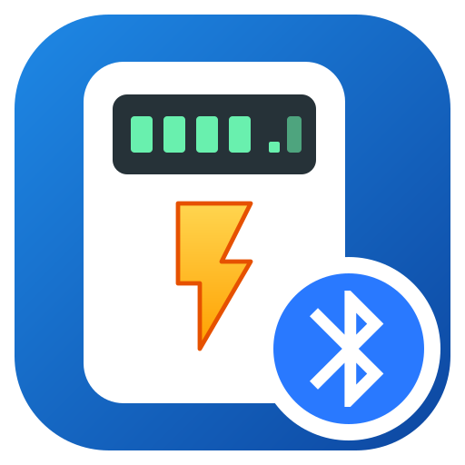

<p align="center">
  
</p>

# Энергомера BLE (CE208/CE308) для Home Assistant

[](https://hacs.xyz/docs/faq/custom_repositories)
[](https://github.com/agapovmax/ha-energomera-ble/actions/workflows/validate.yml)

Пользовательская интеграция Home Assistant для чтения показаний электросчётчиков
**Энергомера CE208 / CE308** со встроенным Bluetooth LE-модулем — напрямую,
без ESPHome и без облака.

*English summary below.*

## Возможности

- Поиск счётчиков в эфире и настройка через интерфейс (мастер с выбором по серийному номеру).
- Автоматическое сопряжение (bonding) по PIN — «BLE-паролю радиоинтерфейса» из формуляра.
- Показания по протоколу МЭК 61107 (ГОСТ Р МЭК 61107) поверх BLE.
- Устойчивость к слабому сигналу: при единичных сбоях сохраняются последние показания
  (до 15 минут), объекты не «мигают» недоступностью.
- Совместимость с панелью «Энергия» Home Assistant.

## Сенсоры

| Группа | Сенсоры |
|---|---|
| Энергия | сумма, T1, T2 (T3, T4, по фазам L1–L3 — выключены по умолчанию) |
| Энергия за сегодня | сумма (T1, T2 — выключены по умолчанию) |
| Мощность | общая, L1–L3, кВт |
| Сеть | напряжение L1–L3, ток L1–L3, cos φ, частота |
| Диагностика | температура счётчика, уровень сигнала (RSSI) |

Создаются только те сенсоры, которые реально вернул счётчик (у однофазного CE208 фаз L2/L3 не будет).

## Требования

- Home Assistant 2024.12 или новее.
- **Локальный** Bluetooth-адаптер на хосте Home Assistant (встроенный или USB).
  Сопряжение по PIN выполняется через BlueZ, поэтому Bluetooth-прокси ESPHome
  для первичного сопряжения не подходят.
- PIN счётчика (6 цифр) — «BLE-пароль радиоинтерфейса» из формуляра; его также
  показывает индикаторное устройство CE901.

## Установка

### Через HACS (рекомендуется)

1. HACS → ⋮ → **Пользовательские репозитории**.
2. Добавьте `https://github.com/agapovmax/ha-energomera-ble`, тип **Integration**.
3. Найдите «Энергомера BLE» и установите.
4. Перезапустите Home Assistant.

### Вручную

Скопируйте папку `custom_components/energomera_ble` в `config/custom_components/`
и перезапустите Home Assistant.

## Настройка

1. **Настройки → Устройства и службы → Добавить интеграцию → «Энергомера BLE»**.
2. Выберите счётчик по серийному номеру и введите PIN.
3. Интервал опроса (по умолчанию 120 с, от 30 до 3600 с) меняется в параметрах интеграции.

## Решение проблем

- **«Счётчики не найдены»** — счётчик слишком далеко или его уже занял другой клиент
  (например, мобильное приложение). Поднесите адаптер ближе / используйте USB-удлинитель.
- **«Счётчик отверг PIN»** — проверьте BLE-пароль; неверное сопряжение удаляется автоматически.
- Для подробного журнала:

  ```yaml
  logger:
    logs:
      custom_components.energomera_ble: debug
  ```

## Благодарности

Протокол обмена по BLE изучен по проекту
[latonita/esphome-energomera-ble](https://github.com/latonita/esphome-energomera-ble).

---

## English

Custom Home Assistant integration for **Energomera CE208 / CE308** electricity meters
with a built-in Bluetooth LE module. Reads energy (total and per tariff), power, voltage,
current, power factor, frequency and meter temperature directly over BLE using
IEC 61107 frames — no ESPHome or cloud needed.

Install via HACS as a custom repository (`Integration` type) or copy
`custom_components/energomera_ble` into your config folder, restart, then add
**Energomera BLE** in *Settings → Devices & services*. You will need the 6-digit
BLE PIN from the meter's passport and a **local** Bluetooth adapter (pairing goes
through BlueZ, so ESPHome Bluetooth proxies are not supported for pairing).

Logo and icon are bundled in `custom_components/energomera_ble/brand/`.

## Лицензия / License

[MIT](LICENSE)
